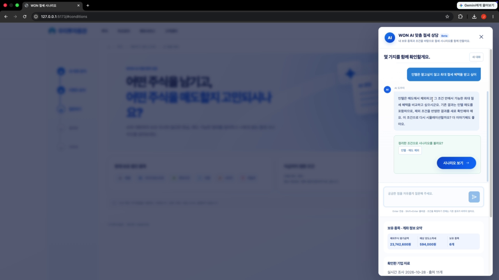
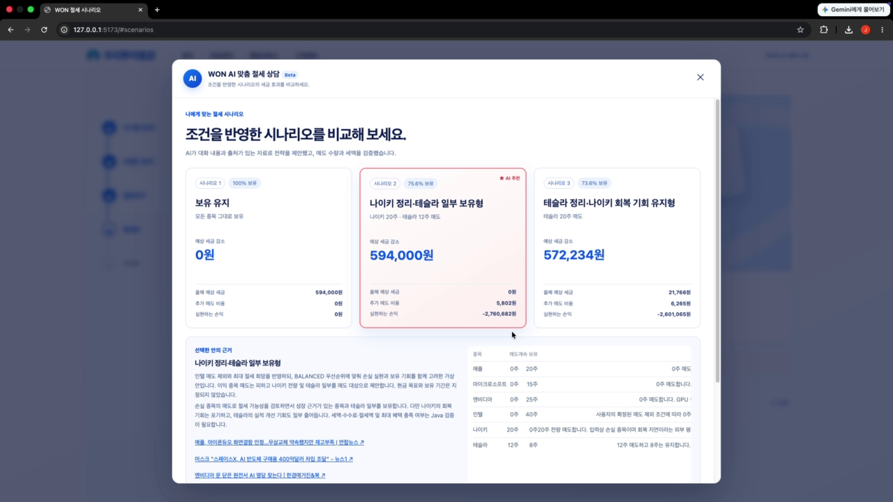
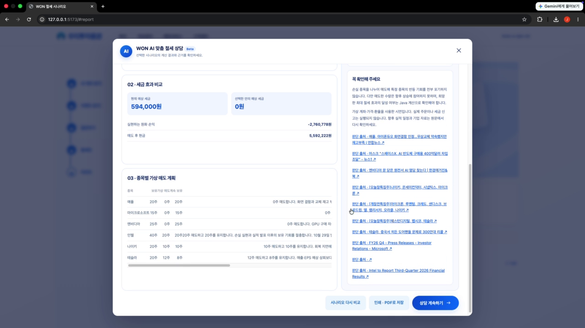

# WON 절세 시나리오 | AI 챗봇

최종관 · 금융 IT 

## 소개

안녕하세요. 금융 서비스에서 사용자가 필요한 정보를 쉽게 이해하고 자신의 상황에 맞는 선택을 할 수 있도록 돕는 개발자가 되고 싶은 최종관입니다.

AX 해커톤에서 해외주식 절세 시나리오 서비스의 AI 챗봇을 개발하며, 사용자의 투자 의사를 대화로 정리하고 시나리오 비교에 반영하는 경험을 했습니다.

## 프로젝트

WON 절세 시나리오 | 우리 AX 해커톤 | 2026.10.26 - 2026.10.28 | 4인 팀 | 구현된 시연용 프로토타입

해외주식 투자자가 손실 중인 주식의 매도를 망설이거나 절세 선택지를 이해하기 어려운 상황을 다뤘습니다. 사용자의 보유 의사를 반영한 시나리오와 예상 세금, 근거를 함께 보여줍니다.

## 나의 기여

OpenAI Responses API를 연동하고 챗봇의 역할과 응답 지침을 설계했습니다. 사용자 발화에서 매도 제외·최대 매도 비율 등의 조건을 추출하고, 모호한 의도는 확인 질문을 하도록 응답 과정을 정리했습니다. AI 응답의 형식과 조건을 확인하는 백엔드 검증 로직도 직접 구현했습니다.

조건을 대화에서 분리해 적용 예정 상태로 관리하고 화면에서 확인한 뒤 사용자가 시나리오 보기를 선택할 수 있도록 백엔드 흐름을 구성했습니다. 기사·공시 원문을 확인할 수 있도록 근거 연결에도 참여했습니다.

팀 결과물에는 React 화면, Spring Boot API, Java 계산 엔진과 기업 자료 검색이 포함됩니다. 저는 챗봇의 백엔드 연동·응답 지침·검증을 담당했으며 React 챗봇 화면은 담당하지 않았습니다. 위 개인 기여는 제 경험에 근거하며 화면·계산 엔진의 전체 구현을 개인 성과로 주장하지 않습니다.

## 구현 흐름

React가 사용자 메시지, 선택 종목, 기존 조건과 대화 ID를 백엔드에 전송합니다. Spring Boot는 최근 대화와 조건 등을 OpenAI에 전달하고, 모델이 반환한 JSON 조건을 검증합니다.

화면은 적용 예정 조건과 확인 질문을 보여줍니다. 사용자가 시나리오 보기를 선택하면 Java가 조건에 따른 세액을 계산합니다. AI 전략 제안의 수량도 서버 측 조건 검증과 계산을 거칩니다.

### 코드로 살펴보기

아래 링크는 팀 저장소에서 관련 구현을 확인할 수 있는 위치입니다. 코드가 존재한다는 사실만으로 개인 작성 여부가 증명되는 것은 아니며, 개인별 작업 기록은 추가 확인 중입니다.

- [OpenAiService.java:61](https://github.com/magici4n/woori-ax-hackathon/blob/5741bc0ebe9ff4029cdacbf510f1e92f5121668a/backend/src/main/java/com/woori/tax/OpenAiService.java#L61): 정해진 JSON 형식으로 응답을 요청하고 Responses API를 호출합니다.
- [AssistantService.java:75](https://github.com/magici4n/woori-ax-hackathon/blob/5741bc0ebe9ff4029cdacbf510f1e92f5121668a/backend/src/main/java/com/woori/tax/AssistantService.java#L75): 챗봇 역할, 조건 추출과 확인 질문에 관한 지침을 구성합니다.
- [AssistantService.java:114](https://github.com/magici4n/woori-ax-hackathon/blob/5741bc0ebe9ff4029cdacbf510f1e92f5121668a/backend/src/main/java/com/woori/tax/AssistantService.java#L114): 사용자 발화, 기존 조건과 최근 대화를 모델 입력에 담습니다.
- [AssistantService.java:128](https://github.com/magici4n/woori-ax-hackathon/blob/5741bc0ebe9ff4029cdacbf510f1e92f5121668a/backend/src/main/java/com/woori/tax/AssistantService.java#L128): AI가 반환한 조건을 읽고 확인 질문과 입력값을 처리합니다.
- [App.jsx:113](https://github.com/magici4n/woori-ax-hackathon/blob/5741bc0ebe9ff4029cdacbf510f1e92f5121668a/frontend/src/App.jsx#L113): 화면의 메시지 전송과 응답 처리 흐름입니다.

## 직접 확인한 시연

입력: “인텔은 팔고싶지 않고 최대 절세 혜택을 받고 싶어” → 인텔 매도 제외 조건을 추출하고 시나리오를 비교했습니다. 영상에서 보유 유지 예상 세금 594,000원과 한 시나리오의 예상 세금 0원을 확인했습니다.

이후 조건을 변경해 살펴본 보고서에서는 예상 세금 594,000원 → 0원, 인텔 20주·나이키 10주·테슬라 12주 매도, 매도 후 현금 5,592,222원을 확인했습니다. 이는 변경된 조건의 결과입니다.

수치는 제공된 시연 영상의 가상 계좌 결과입니다. 현재 실행에서 재현 검증은 하지 않았으며 AI 생성 제목과 결과는 실행 시점 및 입력에 따라 달라질 수 있습니다.

## 문제와 배운 점

조건이 바뀌는 대화에서 이전 맥락이 꼬이거나 특정 종목이 반복 제안되는 어려움이 있었습니다. 추출 조건을 별도 상태로 관리하고 재시뮬레이션에 전달하는 구조가 중요하다는 점을 배웠습니다.

금융 AI에서는 자연스러운 설명뿐 아니라 계산 결과의 검증과 근거 확인이 중요하다는 점을 배웠습니다. 출처 링크는 원문 확인을 돕지만 AI 요약의 정확성 자체를 보장하지는 않습니다.

## 기술과 현재 한계

React·Vite: 대화 화면과 조건 표시 / Java·Spring Boot: API, 검증과 계산 / OpenAI Responses API: 자연어 조건 추출과 웹 검색. 기술 목록은 팀 프로젝트 전체 기준입니다.

시연용 가상 계좌와 가정에 기반하며 실제 계좌 연결이나 주문 기능은 없습니다. 대화 상태는 서버 메모리에 있어 재시작 시 초기화됩니다.

## 근거와 다음 단계

팀 프로젝트 저장소: https://github.com/magici4n/woori-ax-hackathon

제공된 전체 시연 영상에서 인텔 매도 제외 조건, 시나리오 비교와 이후 변경된 조건의 보고서를 확인했습니다. 영상은 당시 시연 화면을 보여주며 현재 실행의 재현 검증과는 구분됩니다.

### 다음 개선 계획

AI 응답과 출처 검증을 더 강화하고 싶습니다. 제안된 응답이 실제 검색 결과의 출처와 연결되는지 확인하고, 출처가 없거나 허용되지 않은 출처를 참조할 때 요약을 표시하지 않는 사례를 테스트할 계획입니다. 유효한 출처는 표시되고 잘못된 출처는 거부되는 테스트가 통과하면 개선 완료를 확인할 수 있습니다. **아직 수행하지 않은 계획입니다.**

개인 작업 기록을 추가로 확보해 기여와 코드의 대응을 확인합니다.

## 시연 화면

다음 이미지는 제공된 프로젝트 시연 영상에서 발췌했습니다.

챗봇이 인텔 매도 제외 조건을 정리하고 시나리오 보기를 제안한 장면.

보유 유지와 두 시나리오의 예상 세금 감소액 및 근거를 비교한 장면.

조건 변경 후 보고서의 예상 세금과 매도 수량, 매도 후 현금을 확인할 수 있습니다.

